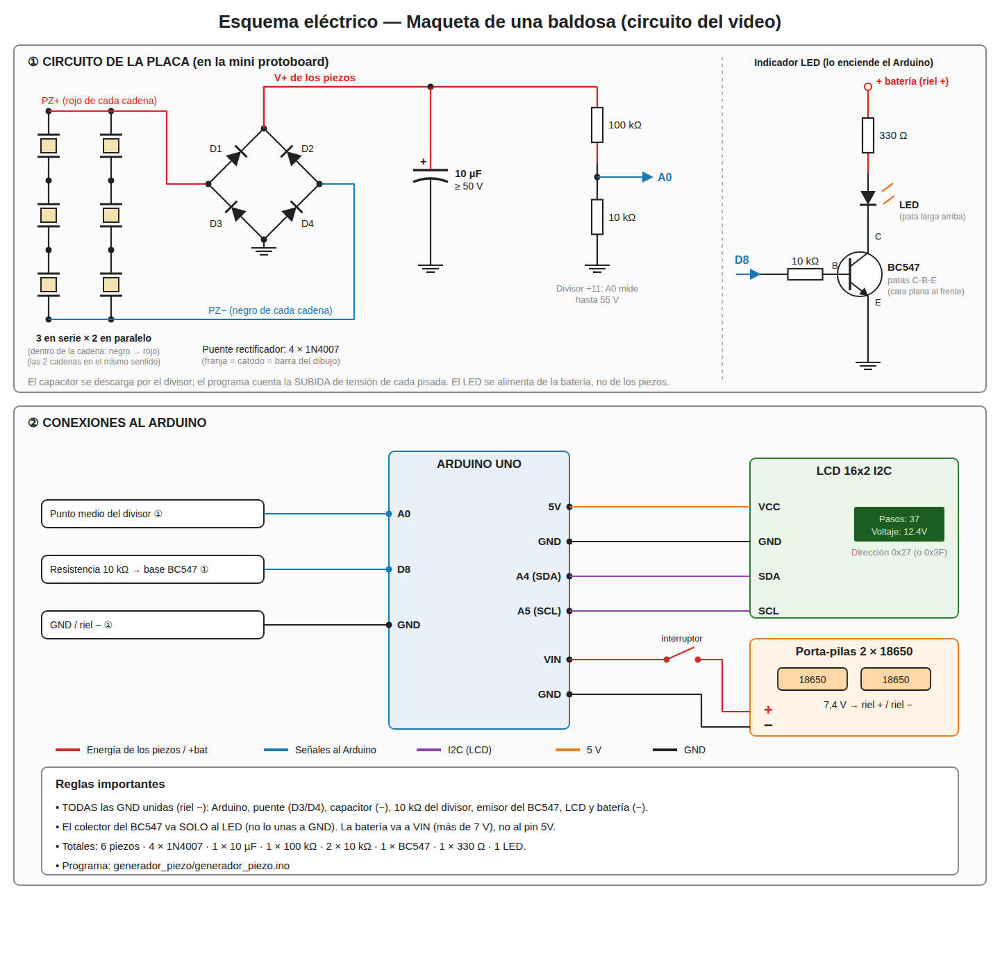

# ⚡ Generador piezoeléctrico de pisadas (Arduino + LCD)

Proyecto basado en el video: https://youtu.be/YZ4OBxyyqOg

Una **placa de acrílico** con **discos piezoeléctricos** debajo genera electricidad
cada vez que alguien la pisa. Un **Arduino UNO** cuenta las pisadas, mide la
tensión generada y la muestra en una **pantalla LCD I2C**. Todo funciona con
**baterías 18650**.

> 🚶 **¿Quieres la versión grande?** Ver [PASARELA.md](PASARELA.md): pasarela de
> **9 baldosas** con mapa en vivo, dirección y velocidad de cruce. Esta maqueta
> sirve para probar los piezos y la estructura de una baldosa.

> ℹ️ El circuito sigue el proyecto de referencia con los mismos componentes del
> video ([Footstep-Energy-Generator](https://github.com/IamHV856156/Footstep-Energy-Generator)),
> con dos errores corregidos: su código no compilaba (`ledPin` sin declarar) y
> en su protoboard el colector del BC547 quedaba unido a GND.



(versión para imprimir: [esquema_maqueta.svg](esquema_maqueta.svg))

---

## 🧩 Cómo funciona

```
  PISADA
    │
    ▼
 ┌──────────────┐   CA    ┌──────────────┐   CC    ┌───────────┐
 │ 6 piezos     │ ──────▶ │ Puente de    │ ──────▶ │ Capacitor │──▶ divisor 100k/10k ──▶ A0
 │ (3S × 2P)    │         │ 4 × 1N4007   │         │ 10 µF     │
 └──────────────┘         └──────────────┘         └───────────┘
                                                        Arduino UNO ──▶ LCD I2C "Pasos: 37"
                                                             │                 "Voltaje: 12.4V"
                                                             └─ D8 ─▶ 10k ─▶ BC547 ─▶ LED
```

1. Al pisar, los piezos se doblan y producen **corriente alterna** (pulsos + y −).
2. El **puente rectificador** (4 diodos 1N4007) la convierte en **continua**.
3. El **capacitor de 10 µF** guarda ese pulso.
4. El **divisor de tensión** (100k + 10k) baja el voltaje para que el Arduino
   lo pueda **medir** por A0 sin dañarse (aguanta hasta ~55 V).
5. Cuando el voltaje **sube de golpe**, el Arduino cuenta una pisada, la muestra
   en el LCD y enciende el **LED** a través del **BC547** (pin D8).

---

## 🛒 Materiales

| Cant. | Componente | Para qué |
|---|---|---|
| 2 | Lámina de acrílico transparente (ej. 30×30 cm) | Base y tapa de la placa |
| 6 | Discos piezo de 35 mm | Generan la electricidad |
| 1 | Arduino UNO | Cerebro |
| 1 | LCD 16x2 con módulo I2C | Pantalla |
| 1 | Mini protoboard | Montar el circuito |
| — | Cables de conexión + jumpers | Conexiones |
| 1 | Capacitor electrolítico 10 µF (≥ 50 V) | Guarda la energía de la pisada |
| 4 | Diodos 1N4007 | Puente rectificador |
| 1 | Transistor BC547 | Enciende el LED |
| 1 | Resistencia 100 kΩ | Divisor (arriba) |
| 2 | Resistencias 10 kΩ | Divisor (abajo) y base del BC547 |
| 1 | Resistencia 220–330 Ω | LED |
| 1 | LED | Se enciende con cada pisada |
| 1 | Porta-pilas 2 × 18650 | Alimentación |
| 2 | Celdas 18650 | Alimentación (7,4 V) |
| — | Pistola de silicona, kit de soldadura | Armado |

---

## 🔌 Conexiones

### 1) Los piezos (3 en serie × 2 en paralelo)

Arma **dos cadenas de 3 piezos en serie** (el cable **negro** de uno con el
**rojo** del siguiente). Después une los extremos: el **rojo libre** de las dos
cadenas juntos (**PZ+**) y el **negro libre** de las dos juntos (**PZ−**).

```
        ┌──[P1]──[P2]──[P3]──┐
 PZ+ ───┤                    ├─── PZ−
        └──[P4]──[P5]──[P6]──┘
```

> - Las dos cadenas tienen que quedar **en el mismo sentido**; si una está al
>   revés, se anulan entre ellas.
> - Prueba con el multímetro (V DC) entre PZ+ y PZ− apretando la placa: tienes
>   que ver un pico de algunos voltios.
> - Comparado con 6 en serie: la mitad de voltaje y el doble de corriente.

### 2) Puente rectificador (4 × 1N4007)

La franja gris del diodo es el **cátodo (−)**.

Conecta cada diodo así (ánodo → cátodo):

| Diodo | Ánodo (sin franja) | Cátodo (franja) |
|---|---|---|
| D1 | PZ+ | **V+** |
| D2 | PZ− | **V+** |
| D3 | **GND** | PZ+ |
| D4 | **GND** | PZ− |

### 3) Capacitor y medición

```
 V+ ──┬──────────────┐
      │              │
    (+)            [100k]
   10µF              ├──── A0
    (−)            [10k]
      │              │
 GND ─┴──────────────┘
```

### 3b) LED con el BC547

```
 + batería ──[330Ω]──▶|── Colector BC547      (LED: pata larga hacia la resistencia)
                  LED
 D8 ──[10k]── Base BC547
              Emisor BC547 ── GND
```

**BC547** (cara plana hacia ti, patas abajo): **C – B – E** (izquierda a derecha).

> ⚠️ El colector va **solo** al LED. No lo unas a GND ni al divisor.

### 4) LCD I2C

| LCD | Arduino |
|---|---|
| GND | GND |
| VCC | 5V |
| SDA | A4 |
| SCL | A5 |

### 5) Alimentación

| Porta-pilas 2×18650 | Arduino |
|---|---|
| + (7,4 V) | **VIN** |
| − | GND |

⚠️ **Todas las GND deben estar unidas** (Arduino, puente, capacitor, BC547, LCD, baterías).

---

## 🔨 Armado de la placa

1. Corta dos láminas de acrílico del mismo tamaño.
2. Pega los piezos sobre la lámina de **abajo** con un punto de silicona
   **solo en el borde** (el disco tiene que poder doblarse). Repártelos parejo.
3. Suelda los piezos en paralelo y saca dos cables (PZ+ y PZ−).
4. Pega pequeños "topes" de silicona en el **centro** de cada piezo:
   la lámina de arriba los presiona al pisar → más flexión → más voltaje.
5. Coloca separadores en las esquinas (silicona, goma o espuma) y pon la
   lámina de **arriba**. Tiene que quedar con un poco de juego.
6. Arma el circuito en la mini protoboard y conecta los dos cables.

---

## 💻 Programa

1. Instala el **Arduino IDE**.
2. Instala la librería: *Herramientas → Administrar bibliotecas →* busca
   **"LiquidCrystal I2C"** (de *Frank de Brabander*).
3. (Si la pantalla no muestra nada) carga `escaner_i2c/escaner_i2c.ino`, abre el
   Monitor Serie a 9600 y anota la dirección (0x27 o 0x3F).
4. Abre `generador_piezo/generador_piezo.ino`, cambia la dirección si hace falta:
   ```cpp
   LiquidCrystal_I2C lcd(0x27, 16, 2);
   ```
5. Selecciona **Arduino UNO** y súbelo.

En la pantalla verás:

```
Pasos: 37
Voltaje: 12.4V
```

- **Pasos**: pisadas contadas.
- **Voltaje**: tensión pico de la última pisada.
- El **LED** destella con cada pisada.

En el Monitor Serie (9600) también se imprime cada pisada.

---

## 🛠️ Si algo falla

| Problema | Solución |
|---|---|
| LCD encendida pero sin letras | Gira el potenciómetro azul de atrás del módulo I2C (contraste) |
| LCD sin nada | Revisa SDA/SCL, usa el escáner I2C y cambia la dirección |
| No cuenta pasos | Baja `UMBRAL_SUBIDA_V` en el código (ej. 0.4) y revisa el puente |
| Cuenta pasos solo | Sube `UMBRAL_SUBIDA_V` (ej. 1.5) |
| Cuenta 2 pasos por pisada | Sube `ANTIRREBOTE_MS` en el código (ej. 900) |
| El LED no enciende | Revisa el BC547 (C-B-E), la pata larga del LED y que D8 vaya a la base por la 10k |
| El LED queda siempre encendido | El colector está unido a GND: sepáralo |
| Voltaje siempre 0 | Revisa el puente de diodos (orientación) y la polaridad del capacitor |
| Voltaje muy bajo | Agrega topes en el centro de los piezos, más piezos, o pisa más fuerte |
| Arduino se reinicia | Batería baja: carga las 18650 (con cargador) |

---

## 📏 Expectativas realistas

- Cada pisada genera del orden de **micro-joules a milijoules**. Es suficiente
  para **encender LEDs por un instante** y para mostrar la medición, pero
  **no** para cargar de verdad una 18650 (harían falta cientos de miles de pisadas).
- Por eso el Arduino funciona con las baterías, y los piezos son la parte que
  se **mide y demuestra**.
- Para cargar las 18650 usa un **módulo TP4056** o un cargador USB.

## 🔒 Seguridad

- Las 18650 tienen mucha energía: **nunca** las pongas en cortocircuito,
  no las perfores y respeta la polaridad del porta-pilas.
- El capacitor electrolítico tiene polaridad: la franja marca el **−**.
- Los piezos pueden dar picos de **decenas de voltios** sin carga: no los
  conectes directo a un pin del Arduino.
